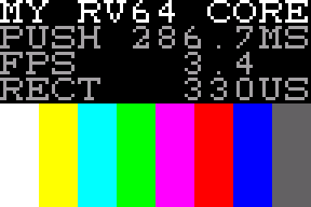

# OLED 实验：给 MCU-0 一块屏幕

Pmod OLEDrgb（Digilent，SSD1331 控制器，96 × 64，16 位色）插在 PYNQ-Z1 的 Pmod JB 口上。这一组实验在 `oled` 分支，
和主线第 1 到 12 步分开记录；每个实验用到主线某一步的成果，也为后面的步骤铺路。

## 实验清单

| # | 实验 | 需要的核 | 学到什么 | 状态 |
| --- | --- | --- | --- | --- |
| 1 | **hello, pixels**：软件 bit-bang 驱动，上电时序、彩条、文字、测帧率 | 第 2 步 | 读数据手册；器件上电顺序；SPI 时序；第一次量出"软件驱动有多慢" | **上板成功** 2026-11-05：你的核，颜色和文字正确，PUSH 287.7 ms |
| 2 | **看见调度器**：`tasks` 的两个任务各占屏幕一条，抢占看得见；去掉关中断，画面撕裂 | 第 4 步 | 竞态条件在屏幕上的样子；临界区 | 待做 |
| 3 | **硬件 SPI 控制器**：Verilog 外设 `mcu_spi`，写一个字节硬件自己移位，FIFO，busy 位（完成中断留作扩展） | 第 2 步（核）；外设是新的 | 外设设计；把软件的活交给硬件；和实验 1 对比测量；CPU 自己成了瓶颈 | **上板成功** 2026-11-05：你的核，动画 bit-bang 4 帧/秒，SPI 控制器 58 帧/秒 |
| 4 | **CPU 仪表盘**：实时显示 mcycle / minstret / CPI / 中断数；再进一步，硬件观察 commit 端口画 PC 直方图 | 第 3 步起 | 性能计数器；不打扰 CPU 的观测 | 待做 |
| 5 | **游戏和演示**：BTN0 到 3 玩贪吃蛇或 Pong；Mandelbrot 做基准，加 M 扩展（第 11 步）前后各跑一次 | 第 4 步；M 之后再测 | 定时器做游戏节拍；同一负载上的 A/B 测量 | 待做 |
| 6 | **xv6 上屏**：6 × 8 字体 16 × 8 个字符，控制台或 `/dev/oled` 驱动 | 第 9 步 | 设备驱动 | 待做 |

## 接线

GPIO OUT 从 8 位加宽到 16 位：OUT[7:0] 仍然是 LED（字节通道 0），OUT[15:8] 接到 JB（字节通道 1）。两个通道分开写，
所以写屏幕的代码用 `sb` 写 `0x1001_0001`，LED 用 `sb` 写 `0x1001_0000`，谁也不碰谁。复位后 JB 全 0，屏幕不上电。

| GPIO OUT | JB 引脚 | FPGA 管脚 | OLEDrgb 信号 |
| --- | --- | --- | --- |
| 8 | 1 | W14 | CS#（低有效） |
| 9 | 2 | Y14 | MOSI（SDIN） |
| 10 | 3 | T11 | 不接 |
| 11 | 4 | T10 | SCK |
| 12 | 7 | V16 | D/C#（0 命令，1 数据） |
| 13 | 8 | W16 | RES#（低有效） |
| 14 | 9 | V12 | VCCEN（屏的高压） |
| 15 | 10 | W13 | PMODEN（Pmod 的逻辑电源） |

管脚来自 PYNQ-Z1 的主约束文件（`jb[0..7]` = `jb_p[1]`, `jb_n[1]`, … ），信号顺序来自 Digilent 的 OLEDrgb IP，
两者和你在 `fpga_101/oledrgb/src/z1top.xdc` 里写的一致。插拔 Pmod 时先给板子断电；注意 Pmod 的 1 号脚对准 JB 的 1 号脚
（看 Pmod 和板子上的丝印）。

## 实验 1：hello, pixels

固件 `oled_hello.c`，驱动 `oled.h`，字体 `font8x8.h`（Digilent，MIT 许可）。只用 RV64I，不用 CSR 和中断，
Makefile 用 objdump 确认没有乘除指令（除法用 `udiv()` 移位相减自己做）。它做四件事：

1. 按数据手册的顺序给屏幕上电（`oled_init`）；
2. 一个像素一个像素地推满整屏（12,288 字节，每位两次 GPIO 写），用 `mtime` 计时；
3. 清屏，用控制器自己的"画矩形"命令画 8 条彩条，也计时；
4. 把两个测量结果写在屏上；之后 LED0 是心跳，按 BTN0 重新测一遍。

### 运行

```sh
cd teaching
make oled-sim                       # 你的核；约 3 分钟；期望 RESULT PASS，屏幕图在 out/oled/oled_hello/screen.png
make oled-sim CORE=../rtl/cpu       # 参考核，约 4 分钟
make oled-sim OLED_FAST=1           # 换成展开的 spi_byte（见练习 1）

make mcu0-bit APP=oled_hello        # 上板：固件 + bitstream，在 mcu0/build-oled_hello/
make mcu0-prog APP=oled_hello
```

仿真里等待时间缩小了 1000 倍（固件 `-DTICKS_PER_MS=40`，模型 `+ms=40`），计时推送只推 8 行再乘 8
（`-DFRAME_SHIFT=3`），否则一次仿真要十几分钟。SPI 本身按真实拍数跑，所以屏上的测量值和板上几乎一样：仿真 286.7 ms，板上 287.7 ms，差 0.35%（原因没有追查）。

### 仿真里屏幕的另一头：`ssd1331_model.v`

testbench 在 JB 上接了一个 SSD1331 的行为模型。它像真控制器一样移位收字节、执行命令、维护 96 × 64 的显存，最后把显存
写成图片。真屏幕会默默出错的地方，模型都报 `OLED ERROR`：

| 检查 | 出处 |
| --- | --- |
| Pmod 没上电或在复位中就发 SPI；RES# 没拉过就开 VCC；VCC 没开就发 AFh（开显示） | 数据手册 7.9 上电顺序 |
| RES# 低电平不足 3 µs | 数据手册 7.9，t1 |
| PMODEN 后不到 20 ms 就复位；VCCEN 后不到 25 ms 就开显示 | Digilent 驱动的等待时间 |
| SCK 周期小于 150 ns；MOSI 或 D/C# 恰好在 SCK 上升沿那一拍变化（没有建立时间）；字节中途拉高 CS# | 数据手册 7.1.3 和串口时序表 |
| 不认识的命令字节；命令参数还没收完就来数据；地址超出 96 × 64 | 数据手册第 9 节命令表 |

这些检查确实会响：把每位两次写改成一次、把 VCCEN 和 PMODEN 同时打开、去掉 20 ms 等待，三种改法各自报出对应的
ERROR，结果 FAIL（2026-11-05 在你的核上试过）。

PASS 还要求：屏幕开了，推送了一帧（仿真里是 1,536 字节），画了至少 8 个矩形和 12 个字符，LED0 心跳开始，
没有总线错误和 trap。

### 测量（2026-11-05）

| | 你的核 | 参考核 |
| --- | --- | --- |
| 每字节拍数（SPI 推送） | 929 | 1,489 |
| 推满一帧（12,288 字节，40 MHz），仿真 | 286.7 ms | 459.4 ms |
| 推满一帧，**板上实测** | 287.7 ms | |
| 帧率（仿真和板上） | 3.4 帧/秒 | 2.1 帧/秒（仿真） |
| 一个矩形命令（13 字节，仿真和板上） | 330 µs | 528 µs（仿真） |
| 加 `OLED_FAST=1`（参考核） | | 1,035 拍/字节，快约 30% |

一字节 929 拍，就是每一位 116 拍：默认的 `spi_byte` 每一位大约 12 条指令，其中 2 条是写 GPIO 的 store。这就是多周期核 + 三拍应答的
路由器的真实速度。同样一块彩条区域，用像素推要 4,096 字节，用矩形命令只要 13 字节，差三百倍：控制器自己会画的东西，
别让 CPU 去推。



### 读代码时注意

- **两次写，不是一次。** `spi_byte` 每一位先写数据（SCK 低），再写一次把 SCK 拉高。合成一次写，MOSI 和 SCK 同一拍
  变化，屏幕采样时数据还没稳——模型会报错，真屏幕会随机收错位。
- **字节写，不是字写。** `LEDS` 和 `JB` 都是 `uint8_t` 指针。如果像 `blink.c` 那样用 64 位写 `GPIO_OUT`，会顺手把
  JB 清零，屏幕当场断电。
- **矩形颜色的位置。** 数据手册 9.2.2：颜色 C、A 在第 5:1 位，B 在第 5:0 位。Digilent 的驱动把 5 位值直接发过去，
  没有左移一位；`oled_rect` 按数据手册来。上板时可以对比两种写法的亮度。
- **红蓝的对应。** 像素格式里 C 在最高 5 位，Digilent 把它当红色。板上验证过（2026-11-05）：`A0` 参数 `0x72` 下
  彩条顺序和颜色都正确，C 就是红。若换一块屏红蓝对调，把 `0x72` 改成 `0x76`（A[2] = 1，SC/SB/SA 反序）。

### 练习

1. 用 `OLED_FAST=1` 重新测，和默认版本比。读 `objdump -d out/oled/oled_hello/oled_hello.elf` 里两个版本的
   `spi_byte`，数一数每位几条指令，算出你的核的 CPI。
2. 把渐变改成用 8 个矩形画的色阶，比较时间。
3. 加一行：用 `udiv` 算出 SPI 的有效比特率（kbit/s）并显示。
4. 想一想：要让一帧小于 20 ms（50 帧/秒），每位最多能花几拍？软件能做到吗？（实验 3 的答案。）

### 还做不到

- 慢：一帧 0.3 秒，推屏期间 CPU 什么也干不了。
- 没有中断：等待全靠轮询 `mtime`。
- 屏幕只能写不能读（SSD1331 的串口只写），要局部更新就得在 RAM 里留一份显存，96 × 64 × 2 = 12 KiB。

## 实验 3：硬件 SPI 控制器

实验 1 里 CPU 用两次 GPIO 写拼出 SPI 的每一位，一帧 287.7 ms。这里把移位交给一个新外设 `mcu0/mcu_spi.v`：CPU 写一个
字节（或一个像素），硬件自己按 SCK 节拍把它移出去。CS# 和 D/C# 还在 GPIO 上，SCK 和 MOSI 在 `CTRL.EN = 1` 时由
控制器驱动，`EN = 0` 时还给 GPIO，所以同一个固件可以在两种方式之间来回切换、当场对比。

### 寄存器（`0x1002_0000`，路由器的第四个从设备）

| 偏移 | 名字 | 读写 | 含义 |
| --- | --- | --- | --- |
| +0x00 | DATA8 | 写 | 一个字节进 FIFO |
| +0x08 | DATA16 | 写 | 一次半字写进两个字节，[15:8] 先发：一个 RGB565 像素一条 `sh` |
| +0x10 | STATUS | 读 | 位 0 BUSY（线上或 FIFO 里还有字节），位 1 FULL（空位不足 2 个），位 2 OVERFLOW（有写入因为满而被丢弃；写 CTRL 清除） |
| +0x18 | CTRL | 读写 | 位 0 EN；位 15:8 DIV，SCK 每半周期 DIV 拍（0 当 1）。复位 EN = 0，DIV = 4：每位 8 拍，40 MHz 下 5 MHz |

FIFO 8 字节。从设备接口没法让写入等待，所以写满就丢、置 OVERFLOW：软件必须先看 FULL。改 CS#、D/C# 之前必须等 BUSY
清零（`oled.h` 的 `jb()` 会等）：D/C# 在每个字节的第 8 个上升沿才被采样，字节还在线上就改它，这个字节就算错了。

### 运行

```sh
make oled-sim APP=oled_spi                  # 约 2 分钟；先测两种方式各推一帧，再用 SPI 控制器跑动画
make oled-sim APP=oled_spi MCU0_SPI=work/mcu_spi.v     # 用你自己写的控制器（练习 1）
make mcu0-bit APP=oled_spi && make mcu0-prog APP=oled_spi
```

板上：先显示对比（BIT-BANG / SPI MASTER 各一帧的时间和倍数）三秒，然后是一个方块在渐变上弹跳，每帧整片
96 × 56 重画，最上一行是每秒帧数。**SW0 拨到 0 是 bit-bang，拨到 1 是 SPI 控制器**，拨一下就能看到差别。BTN0 重新测。
LED0 每帧翻转一次，LED1 亮表示正在用 SPI 控制器。

### 测量（仿真，2026-11-05）

| 每字节拍数 | 你的核 | 参考核 |
| --- | --- | --- |
| bit-bang（oled_spi 里） | 954 | 1,529 |
| SPI 控制器，渐变（每像素还要算颜色） | 68 | 110 |
| SPI 控制器，动画帧 | 64 | 75 |
| 线上的极限（DIV = 4：8 位 × 8 拍） | 64 | 64 |

你的核：渐变一帧约 21 ms，比 bit-bang 快约 14 倍；动画一帧（10,752 字节）17.2 ms，约 58 帧/秒，正好贴着线速。
**板上实测**（2026-11-05，你的核）：动画 SW0 = 0 时 4 帧/秒，SW0 = 1 时 58 帧/秒，和仿真一致。
参考核跟不上：每个像素算颜色、查 FULL、写 DATA16 花的拍数比线上发两个字节的 128 拍还多，**CPU 自己成了瓶颈**。
外设快了以后，瓶颈换了地方：这正是练习 3 要量的。

### 模型怎么检验控制器

还是 `ssd1331_model.v`，它不关心 SCK 是软件还是硬件拼出来的。试过的四种错误（2026-11-05，你的核）：

| 错误 | 结果 |
| --- | --- |
| `SPI_DIV=2`：SCK 周期 4 拍 = 100 ns | `SCK period under 150 ns` |
| 固件不看 FULL 就写 DATA16 | FIFO 溢出，`spi_overflow=1`，FAIL |
| 固件改 CS# 前不等 BUSY | `CS# raised in the middle of a byte` |
| 控制器在 SCK 上升沿换 MOSI（RTL 变异体） | `MOSI changed on the rising SCK edge itself` |

### 练习

1. **自己写 `mcu_spi`。** 只看上面的寄存器表，不看 `mcu0/mcu_spi.v`，写 `work/mcu_spi.v`，用
   `MCU0_SPI=work/mcu_spi.v` 跑 `oled-sim APP=oled_spi` 和 `APP=oled_hello`（后者确认 EN = 0 时不碍事）。
2. 把 `SPI_DIV` 改成 3（6.67 MHz，数据手册的上限）再测：你的核还跟得上吗？
3. 找出 CPU 的瓶颈：`frame()` 每个像素都要读一次 STATUS 查 FULL，而 FULL 清零只保证还有一个像素的空位。给控制器
   加一个状态位（比如"空位至少 6 字节"），让固件每 3 个像素才查一次，在参考核上量一下省了多少。
4. 加一个"FIFO 空了"中断，接到核的 `irq_meip`（第 4 步的外部中断线），让 CPU 在发送期间去做别的事。

### 还做不到

- 等待仍然是轮询：CPU 在 FULL 上空转。练习 4 是下一步。
- 一帧仍然要 CPU 逐像素算出来再写；真正的显示系统会让控制器自己从内存里读（DMA）。

## 文件

| 文件 | 内容 |
| --- | --- |
| `oled.h` | bit-bang SPI 和 SPI 控制器两条路径、上电初始化、窗口、像素、矩形、清屏、8 × 8 字符、无除法的十进制输出 |
| `oled_hello.c` | 实验 1 的固件 |
| `oled_spi.c` | 实验 3 的固件：对比测量 + SW0 切换的弹跳动画 |
| `../mcu0/mcu_spi.v` | 实验 3 的 SPI 控制器（MCU-0 的第四个从设备） |
| `font8x8.h` | ASCII 0x20–0x7F 字形，Digilent ChrFont0（MIT），原样拷贝 |
| `ssd1331_model.v` | 仿真用的屏幕模型和全部检查 |
| `tb_oled.v` | testbench：mcu_top + 模型，判定 PASS/FAIL，写出 `screen.ppm` |
| `img/hello-sim.png` | 你的核仿真出的屏幕（2026-11-05） |
| `../tools/ppm2png.py` | 把 `screen.ppm` 放大 4 倍转成 PNG，只用标准库 |

依据：SSD1331 数据手册 rev 1.2（Solomon Systech）第 7.1.3、7.9、9 节；Digilent vivado-library
`ip/Pmods/pmodOLEDrgb_v1_0`（提交 0362ce72）的 `PmodOLEDrgb.c` 初始化序列和 `ChrFont0.h`。
