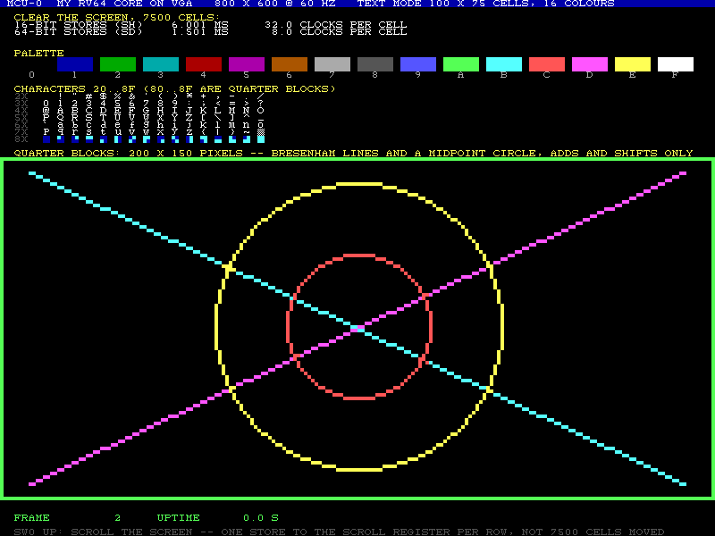
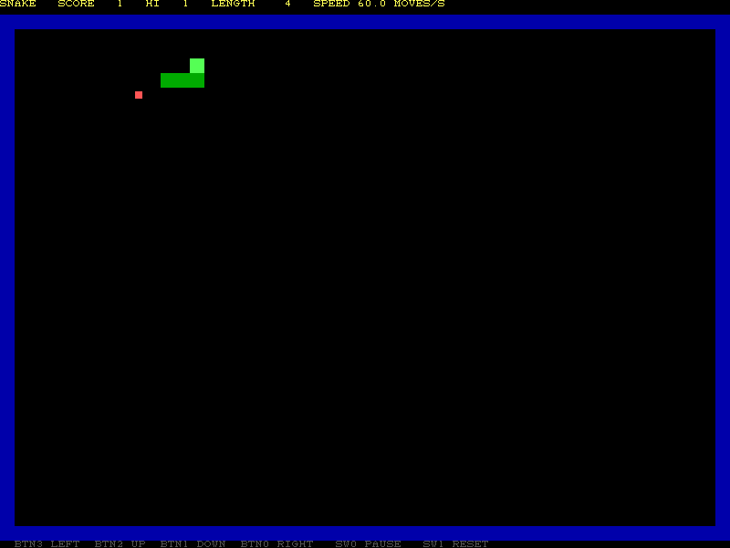
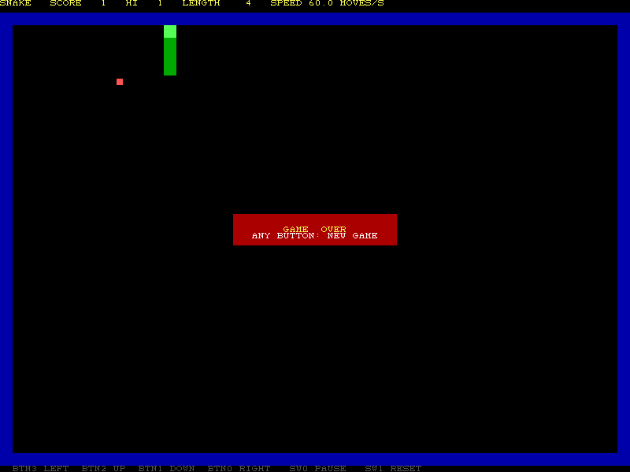
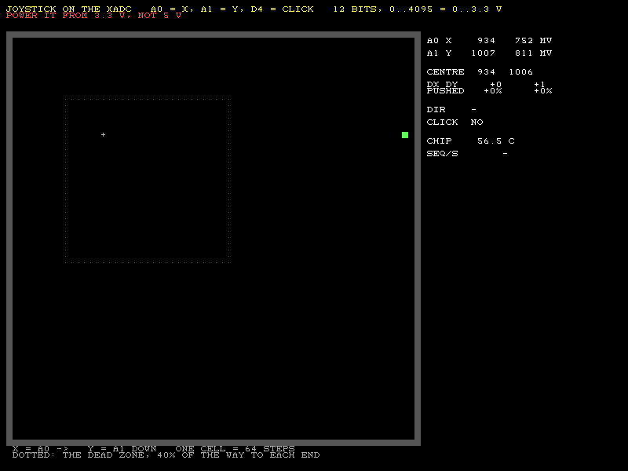

# VGA 实验：给 MCU-0 接一台显示器

Digilent Pmod VGA 横跨 PYNQ-Z1 的 **JA 和 JB** 两个 Pmod 口，接一台普通 VGA 显示器。这一组实验在 `vga` 分支（从 `oled`
分支开出来，共用字体和数字输出），和主线第 1 到 12 步分开记录。

和 OLED 比，VGA 是另一种显示方式：OLED 自己有显存，CPU 通过 SPI 一条条命令去改它；VGA 显示器**没有**显存，每秒 60 次、
每行每个像素都要按精确的时序送过去。CPU 做不了这件事，所以要一块硬件 `mcu_vga` 自己去扫描一块存储器，CPU 只往存储器里写。
画图于是变成了普通的存储指令：没有 SPI，没有命令字节，也没有"等 1 ms"之类的猜测。

## 实验清单

| # | 实验 | 需要的核 | 学到什么 | 状态 |
| --- | --- | --- | --- | --- |
| 1 | **hello, VGA**（`vga_hello`）：文字模式控制器 + 测试画面：调色板、字符表、四分块画线画圆、实时帧计数、硬件滚屏 | 第 2 步 | 视频时序；流水线对齐；双口 RAM；"只在消隐期改画面"；存储宽度对速度的影响 | **上板成功** 2026-11-05：你的核，画面正确，清屏 6.0 ms / 1.5 ms，和仿真一致 |
| 2 | **控制台**：`putchar`/`printf` 输出到屏幕，满屏后用 SCROLL 寄存器滚动；以后给第 6 步和 xv6 当控制台 | 第 2 步 | 设备驱动的雏形；滚屏为什么不用搬 7,500 个字符 | 待做 |
| 3 | **大屏贪吃蛇**（`vga_snake`）：OLED 贪吃蛇的游戏逻辑，棋盘从 24 × 14 变成 48 × 34，用显示器的帧当节拍 | 第 2 步 | 同一个游戏逻辑换一种显示；帧计数当时钟，不用中断；每一步都在消隐期画 | **上板成功** 2026-11-05：你的核，画面干净、手感好 |
| 5 | **摇杆**（`vga_joystick`，`vga_snake` 也能用）：模拟摇杆接 Arduino 排针，FPGA 内置的 XADC 读两路电压；屏幕上一个点跟着摇杆走，贪吃蛇可以用摇杆操纵 | 第 2 步 | 模拟量怎样变成数字；硬核外设（XADC）和它的 DRP 口；校准中心、死区、迟滞 | **上板成功** 2026-11-06：你的核；静止位置被板上分压拉低（X 935、Y 1007，两端 12 到 3980），按比例死区后四个方向、按下、暂停都正常；XADC 每秒约 6,400 个序列 |
| 4 | **像素模式**：200 × 150、12 位色的帧缓冲，Mandelbrot 做基准，加 M 扩展前后各跑一次 | 第 2 步；M 之后再测 | 帧缓冲和文字模式的取舍：存储器多大、CPU 要写多少 | 待做 |
| 6 | **数字输入在哪里翻转**（`vga_threshold`）：A0 同时接 XADC 和一个普通数字输入，慢慢推摇杆，屏幕上画出"读到 1 的时间比例"随电压变化的曲线 | 第 2 步 | 数字输入其实是一个比较器；数据手册保证的 0.8 V / 2.0 V 和这颗芯片实际的翻转点；没有迟滞的输入在阈值附近会抖；异步输入要同步 | 仿真通过，待上板 |

## 接线

Pmod VGA 有两排插针，插头 J1 插 **JA**，J2 插 **JB**（看 Pmod 上的丝印，1 号脚对 1 号脚）。插拔前先给板子断电。
它占用 JB，所以和 OLEDrgb 不能同时用：用 VGA 时把 OLED 拔下来。

| Pmod 口 | 引脚 | FPGA 管脚 | 信号 |
| --- | --- | --- | --- |
| JA | 1–4 | Y18, Y19, Y16, Y17 | R0–R3（红，低位在前） |
| JA | 7–10 | U18, U19, W18, W19 | B0–B3（蓝） |
| JB | 1–4 | W14, Y14, T11, T10 | G0–G3（绿） |
| JB | 7 | V16 | HSYNC |
| JB | 8 | W16 | VSYNC |

管脚和你在 `fpga_101/pmod_vga/src/z1top.xdc` 里用的一样。板级参数 `PMOD_VGA=1`（`make mcu0-bit APP=vga_*` 会自动加）
把 VGA 信号接到 JA + JB；`PMOD_VGA=0`（其他应用）时 JA 输出 0，JB 照旧给 GPIO 和 SPI。

## 为什么是 800 × 600

VESA 的 800 × 600 @ 60 Hz 标准像素时钟正好是 **40.000 MHz**，就是 MCU-0 的时钟。所以视频逻辑直接跑在 CPU 的时钟上，
一拍一个像素：不需要另一个 MMCM 输出，也没有跨时钟域。（你之前的 `fpga_101/pmod_vga` 是 640 × 480，用 125 MHz 五分频得到
25 MHz，比标准的 25.175 MHz 低一点。）

| | 可见 | 前肩 | 同步 | 后肩 | 合计 |
| --- | --- | --- | --- | --- | --- |
| 水平（时钟） | 800 | 40 | 128 | 88 | 1056 |
| 垂直（行） | 600 | 1 | 4 | 23 | 628 |

两个同步信号都是**高有效**（640 × 480 是低有效，这是两种模式容易弄混的地方）。帧率 40 MHz ÷ (1056 × 628) = 60.3 Hz。

## 文字模式

屏幕分成 100 × 75 个 8 × 8 的字符格。一个格子是文字 RAM 里的一个半字：

```
15      12 11       8 7                 0
| 背景色  |  前景色   |       字符        |
```

- 字符 0x20–0x7F 是 ASCII（和 OLED 同一套 Digilent 字体），0x80–0x8F 是**四分块**：低 4 位分别点亮左上、右上、左下、
  右下四分之一。于是文字模式也能画 200 × 150 的"像素"图，代价是每个格子只有两种颜色。
- 颜色是固定的 16 色调色板（CGA 那一套）：

| 编号 | 颜色 | RGB444 | 编号 | 颜色 | RGB444 |
| --- | --- | --- | --- | --- | --- |
| 0 | 黑 | 000 | 8 | 深灰 | 555 |
| 1 | 蓝 | 00A | 9 | 亮蓝 | 55F |
| 2 | 绿 | 0A0 | A | 亮绿 | 5F5 |
| 3 | 青 | 0AA | B | 亮青 | 5FF |
| 4 | 红 | A00 | C | 亮红 | F55 |
| 5 | 品红 | A0A | D | 亮品红 | F5F |
| 6 | 棕 | A50 | E | 黄 | FF5 |
| 7 | 浅灰 | AAA | F | 白 | FFF |

为什么是文字模式而不是直接存像素：800 × 600 × 12 位要 720 KB，比整个 MCU-0 的 RAM 大十倍；文字模式只要 15 KB 文字 RAM
加 2 KB 字体 ROM，CPU 改一个字符也只要写一个半字（像素模式要写 64 个像素）。

### 地址（基址 0x1003_0000，64 KiB 窗口）

| 偏移 | 名字 | | 内容 |
| --- | --- | --- | --- |
| +0x0000 – +0x3A97 | 文字 RAM | 读写 | 格子 (x, y) 在 `2 × (y × 100 + x)`，任何宽度都能读写 |
| +0x4000 | FRAME | 读 | 复位以来的帧数，每次进入垂直消隐时加 1 |
| +0x4008 | STATUS | 读 | bit 0 VBLANK（光束在两帧之间，第 600–627 行），bits 25:16 光束当前在第几行 |
| +0x4010 | SCROLL | 读写 | bits 6:0：屏幕最上面显示文字 RAM 的第几行（0–74），下面的行依次跟上、到底回绕 |

`y × 100` 用移位做：`(y << 6) + (y << 5) + (y << 2)`，硬件和 `vga.h` 都这样算，RV64I 没有乘法。

### 硬件里面：三级流水线

```
计数器 hc, vc ──► 第 1 拍：文字 RAM ──► 第 2 拍：字体 ROM ──► 第 3 拍：调色板 ──► R, G, B
   (格子地址)        (读出字符和颜色)     (这一行的 8 个点)      (选前景或背景色)
hsync, vsync, 可见 ──► 打一拍 ──────────► 打一拍 ────────────► 打一拍 ──────────► HS, VS
```

每个像素要先从文字 RAM 读出字符，再用字符去字体 ROM 查这一行的点阵，再选颜色：三次连续的同步读。同步信号和"是否可见"
标志也要走同样的三拍，否则图像会相对同步信号错开几个像素，显示器上整个画面往左或往右偏。测试里的变异体 1 就是少打一拍。

文字 RAM 是**双口**的：一个口给 CPU（路由器的一拍从设备接口，支持按字节写），一个口只读、给光束。两边同时访问互不等待，
所以 CPU 写屏幕从来不会被显示拖慢，显示也不会因为 CPU 在写而断。

板上实现（你的核，`PMOD_VGA=1`）：`mcu_vga` 用 155 个 LUT、132 个触发器、4 个 RAMB36（文字 RAM）和 1 个 RAMB18（字体）；
40 MHz 下最差裕量 8.7 ns。

## 只在消隐期改画面

光束每帧从上到下扫一遍。如果 CPU 改一个格子的时候光束正好扫到它，这一帧里这个格子上半截是旧的、下半截是新的，叫
**撕裂**（tearing）。数字一直变的地方（帧计数）会一闪一闪地看到半个数字。

办法是在**垂直消隐**时改：第 600 行之后光束有 28 行（29,568 拍）不在屏幕上，这时写进去的东西下一帧整个出现。
`vga_hello` 的主循环是：

1. 先把要显示的文字准备好（`fmt_fixed` 要做除法，慢）；
2. `vga_wait_frame()`：等 FRAME 变化，也就是消隐刚开始；
3. 只做存储，把准备好的文字写进去。

消隐期只有 0.74 ms，所以慢的事要放在等待之前做。测试平台检查这个约定：画面画好之后，光束在可见区时出现任何对 VGA 的写，
都算一次 LATE STORE，测试失败（变异体 6：去掉等待）。

## 实验 1：hello, VGA

固件 `vga_hello.c`，驱动 `vga.h`（基础函数在 `teaching/mcu0/mcu0.h`）。只用 RV64I，Makefile 用 objdump 确认没有乘除和 CSR 指令。

1. **测量**：用 16 位存储（`sh`）把 7,500 个格子清一遍，再用 64 位存储（`sd`，一次 4 个格子）清一遍，显示两次的时间。
2. **画**：调色板、字符表、四分块的 Bresenham 直线和中点画圆（只用加法和移位）。
3. **实时**：每帧在消隐期更新帧计数和开机时间。SW0 拨上：每 6 帧把 SCROLL 加 1，整屏向上滚，一次存储滚一行。

LED：LED1 = 画面画好了，LED0 每 30 帧翻转（一秒闪一次），LED2 = 在滚屏。

```sh
cd teaching
make vga-sim                     # 你的核；画面在 out/vga/vga_hello/screen.png（800 × 600）
make vga-sim VGA_SW=1            # 打开 SW0：每帧滚一行，检查滚屏回绕
make vga-sim CORE=../rtl/cpu     # 参考核
make mcu0-bit APP=vga_hello      # 比特流（自动加 PMOD_VGA=1）
make mcu0-prog APP=vga_hello     # 烧进 PL
```

仿真里 LED0 每帧翻转、滚屏每帧一行（`HEART_FRAMES=1`、`SCROLL_FRAMES=1`），仿真大约 260 万拍，三帧多。



### 测量（仿真）

| 核 | 16 位存储清屏 | 64 位存储清屏 |
| --- | --- | --- |
| 你的核 | 6.0 ms，每格 32 拍（板上实测 6.0 ms） | 1.5 ms，每格 8 拍，每次存储 32 拍（板上实测 1.5 ms） |
| 参考核 | 9.4 ms，每格 50 拍 | 2.3 ms，每格 12.5 拍 |

每次存储大约 32 拍，远不止路由器那 4 拍：清屏循环一圈是 3 条指令（`sh`、`addi`、`bne`），每条都要先经路由器取指，
而取指和存储走的是**同一个**端口、同一个路由器，一个接一个排队。所以一次写 4 个格子正好快 4 倍：CPU 的瓶颈是"一圈循环"，不是写了多少字节。对比 OLED：实验 1
用 bit-bang 送一个 8 × 8 字符要 128 字节、十几万拍；这里写一个字符是一次存储。

## 实验 3：大屏贪吃蛇

固件 `vga_snake.c`。游戏规则、按键、两格转向队列、消抖、没有除法的随机数都和 `teaching/oled/oled_snake.c` 一样，
变的是显示这一半：

| | OLED 贪吃蛇 | VGA 贪吃蛇 |
| --- | --- | --- |
| 棋盘 | 24 × 14，4 × 4 像素一格 | 48 × 34，16 × 16 像素一格（2 × 2 个字符），外面一圈蓝边 |
| 节拍 | CLINT 定时器中断，`ticks++` | 显示器的帧：每 `speed` 帧走一步（开局 9 帧 = 150 ms，每吃两个快一帧，最快 4 帧） |
| 走一步的绘制 | 3 个方块，约 35 个 SPI 字节加 3 ms 固定等待 | 3 个方块，12 次存储，几百拍 |
| 什么时候画 | 随时（OLED 自己有显存，不会撕裂） | 新的一帧刚开始、光束在消隐期时 |
| 需要的核 | 第 4 步（中断） | 第 2 步（只轮询） |
| 游戏结束 | OLED 控制器的变暗命令 | 一个红色提示框，也在一次消隐期里画完 |

用帧当节拍是 VGA 自带的便利：显示器本来就每 16.7 ms 给一次"现在可以画了"的信号，游戏的步子和画面的帧对齐，
每一步都在消隐期画完，不会撕裂，也不需要中断。代价是速度只能是 60 Hz 的整数分之一（6.7、7.5、8.6、10、12、15 步/秒）。

状态栏的数字要用 `udiv` 算，太慢，放不进消隐期：吃到食物时先在消隐期画完方块，**之后**再准备状态栏文字，
到下一个消隐期才写上去。变异体 7 就是"算完马上写"，测试平台报 LATE STORE。

操作：BTN3 左、BTN2 上、BTN1 下、BTN0 右；SW0 拨上暂停；SW1 拨上复位（`RESET_SW1=1`，`make mcu0-bit APP=vga_snake`
会和 `PMOD_VGA=1` 一起加）；撞了之后按任意键重来。LED：LED0 每步翻转，LED1–2 是分数的低两位，LED3 = 游戏结束画面已显示。

```sh
make vga-sim APP=vga_snake       # 约 10 分钟：860 万拍，每拍都逐像素检查
make mcu0-bit APP=vga_snake
make mcu0-prog APP=vga_snake
```

仿真用 OLED 贪吃蛇同一个脚本 `teaching/oled/snake.script`：第 3 步按左（正后方，必须被忽略），第 8 步按上，从第 3 行
出发（`START_Y=3`，仿真里每帧一步），吃到一个食物后撞上边墙，结束时 LED3..1 必须是 101。从第一步开始逐帧判，到游戏结束
画面之后两帧为止；中途第 9 步的画面存为 `mid.png`。

| 第 9 步 | 游戏结束 |
| --- | --- |
|  |  |

## 实验 5：摇杆

常见的五脚摇杆模块（GND、+5V、VRx、VRy、SW）。它不是开关，是两个电位器：每个方向输出一个电压，不动时大约在电源电压一半，
推到头时接近 0 V 或电源电压。数字引脚只能分辨高低，读不出"推了多少"，要用模数转换器（ADC）。

### 接线（Arduino 排针，母对公杜邦线）

| 摇杆 | 板子 | 说明 |
| --- | --- | --- |
| GND | GND | |
| +5V | **3.3V** | **不要接 5V**：摇杆输出最高等于它的供电，5 V 进 FPGA 引脚会损坏引脚。电位器在 3.3 V 下照样工作 |
| VRx | A0 | XADC 的 VAUX1 |
| VRy | A1 | XADC 的 VAUX9 |
| SW | D4 | 按下摇杆时接地；FPGA 引脚开了上拉（`pynq-z1.xdc`），GPIO IN 第 6 位 = 1 表示按下 |

和 Pmod VGA 不冲突（VGA 在 JA/JB）。**上电或复位时不要碰摇杆**：固件把复位那一刻的位置当作中心。

### 硬件：XADC 和 `mcu_adc`

Zynq 里有一块现成的 ADC 硬核 XADC：12 位、每秒 100 万次，带一个自己按顺序扫描多个通道的"排序器"。PYNQ-Z1 把 A0–A5
经过电阻分压（3.3 V → 1 V）接到 XADC 的辅助输入上，所以读数 0..4095 对应引脚上的 0..3.3 V。

`mcu_board.v` 实例化 XADC，配置成连续扫描：校准、芯片温度、VAUX1（A0）、VAUX9（A1），每个通道 16 次取平均。
板上实测每秒约 6,400 轮（每轮约 0.16 ms）。XADC 的结果放在它自己的状态寄存器里，要通过 **DRP**（动态重配置口：给地址、拉一拍 DEN、等 DRDY 回来
16 位数据）去读。`mcu_adc.v` 替 CPU 做这件事：每当 XADC 发出 EOS（一轮扫完），它就把三个结果读出来存好，CPU 读的是
普通寄存器，一拍就有，不用等转换器：

| 地址（基址 0x1004_0000，4 KiB） | 名字 | 内容 |
| --- | --- | --- |
| +0x00 | X | A0，0..4095 |
| +0x08 | Y | A1，0..4095 |
| +0x10 | TEMP | 芯片温度原始值：°C = TEMP × 503.975 / 4096 − 273.15 |
| +0x18 | COUNT | 扫完的轮数；它一变，X、Y、TEMP 就是新的（板上约每秒 6,400 次） |

XADC 是 Xilinx 的硬核，iverilog 跑不了它的模型。所以 DRP 从 `mcu_top` 引出来：板子上接真的 XADC，仿真里接
`xadc_model.v`（每 4000 拍一个 EOS，读数带 ±2 的噪声，低 4 位也是噪声，`mcu_adc` 必须丢掉）。

### 固件：从电压到方向（`teaching/mcu0/adc.h`）

**板上实测，静止的摇杆不在中间**：X ≈ 935（0.75 V）、Y ≈ 1007（0.81 V），而不是 2048（1.65 V）；推到头时是 12 和
约 3980。原因是负载：PYNQ-Z1 的 A0–A5 经过一个到地的电阻分压器（几 kΩ）才到 XADC，摇杆的 10 kΩ 电位器在中间位置
内阻最大（约 2.5 kΩ），被分压器一拉，电压就掉了一半；推到头时电位器内阻接近 0，所以两端还是满的。
结果是从中心往小的一边只有约 900 步可走，往大的一边约 3000 步。第一版固件假设"静止在 1024..3072 之间"、
"死区 ±800 步"，上板就判成了"没有摇杆"。这是一个典型的教训：**模拟信号要看信号源的内阻和输入端的负载**，
光看电压范围不够。

1. **检测和校准**：复位时读 16 次取平均。两个轴都明显离开两端（0.24 V..3.06 V 之间），说明插着一个静止的摇杆，
   这个平均值就是中心；没插的时候分压电阻把引脚拉到 0 V，读数接近 0，判为"没有摇杆"，贪吃蛇就只用按键。
2. **按比例算推了多少**：偏移除以那一边能走的距离（中心往下是 cx，往上是 4095 − cx），1024 = 推到头。
   这样两边不对称也没关系。除法用 `mcu0.h` 的 `udiv`（RV64I 没有除法指令）。
3. **死区**：推出不到一定比例算"没推"。不然手稍微一抖、或者 ADC 噪声，蛇就会转向。
4. **迟滞**：推出 40% 才算开始推，退回 20% 以内才算松开。两个门槛之间什么都不变，
   所以摇杆停在某个门槛附近时，噪声不会让方向一会儿有一会儿没有。
5. 推得更多（按比例）的那个轴决定方向。

### `vga_joystick`：看见读数

左边 64 × 64 格的框里，一个点跟着摇杆走（每格 64 个 ADC 步长），虚线方框就是死区（每边 40%，所以不在框的正中）；方向成立时点变绿，按下时变红。
右边是原始读数、引脚电压（mV，用移位相加算 ×3300/4096，不用乘法）、校准出的中心、偏移（步数和百分比）、方向、
芯片温度和 XADC 每秒扫多少轮。LED：LED0 心跳，LED1 画好，LED2 找到摇杆，LED3 推着或按着。GPIO OUT 的 JB 字节（用 VGA 时它不接任何引脚）= 方向
（0 右、1 下、2 左、3 上、4 没推）+ 按下时 16，测试平台最后核对它。

右边面板每帧重写 10 行 × 28 格。一开始是用 `vga_text` 一格一格写的：参考核上每格约 115 拍，一共约 3 万拍，比消隐期
（29,568 拍）还长，测试平台报 LATE STORE。改成先在内存里拼好、每次 `sd` 写 4 格（面板左边界放在第 68 列，4 的倍数，
每行正好 7 个双字），63 次存储就够了。



上图是仿真里往右推之后的那一帧：点已经到了右边、变成绿色，右边的面板还是上一帧的数字。这是有意的顺序：点的位置
只是一次移位，在等帧之前就算好；面板的十进制数字慢，在存储之后才准备，所以总是晚一帧显示。

**方向**：上板实测，按上表接线，往右推 X 变大、往下推 Y 变大，和默认设置一致。换一种拿法时如果反了
或者 X、Y 对调了，在 `adc.h` 里改 `JOY_FLIP_X`、`JOY_FLIP_Y`、`JOY_SWAP_XY`（或者编译时 `-D`），不用改硬件。

### 贪吃蛇用摇杆

`vga_snake.c` 复位时检测摇杆。找到了，底部提示行会写着摇杆的用法：推一下转向（推出死区的那一刻算一次"按键"，
一直推着不会重复排队），按下摇杆暂停/继续；按键照样能用。游戏结束后，松开摇杆再推一下，或者按任意键，重新开始。

```sh
make vga-sim APP=vga_joystick              # 约 9 分钟：摇杆静止，第 2 帧往右推，第 4 帧往上推并按下
make vga-sim APP=vga_joystick JOY=0        # 没插摇杆：LED2 必须灭
make vga-sim APP=vga_snake JOY=1           # 同一局贪吃蛇，用摇杆操纵（vga/snake-joy.script）
make mcu0-bit APP=vga_joystick && make mcu0-prog APP=vga_joystick
```

`tb_vga.v` 的脚本里，按键值高于按键的几位用来动摇杆：第 4 位右、5 下、6 左、7 上、第 8 位按下（`+joy=1` 时才有摇杆）。

## 实验 6：数字输入在哪里翻转

数字输入并不"天生"只有 0 和 1。输入缓冲器其实是一个比较器：引脚电压高于某个阈值读 1，低于读 0。LVCMOS33 标准只保证
**低于 0.8 V 一定读 0、高于 2.0 V 一定读 1**，中间这 1.2 V 里读成什么，标准不管，由这颗芯片、这个温度、这一刻的噪声决定。
这个实验把同一个电压同时交给 ADC 和一个数字输入，亲眼看翻转点在哪里。

### 接线：不用加线

PYNQ-Z1 的 A0 排针本来就连着两个 FPGA 管脚：一路经过分压进 XADC（实验 5 用的 VAUX1），另一路**直接**连到普通管脚 Y11
（板子总约束文件里叫 Arduino "数字 14"）。所以摇杆照实验 5 那样接好就行，只用 X 轴（A0）。`pynq-z1.xdc` 把 Y11 声明成
输入，不加上拉也不加下拉，只"听"。

顺便一个观察：Vivado 默认给**没用到**的管脚加一个弱下拉。以前 Y11 没用，它的下拉一直挂在 A0 上；现在 Y11 成了输入，
下拉没了。对照实验 5 记下的静止读数（X ≈ 935），看看 X 是不是变高了一点：这也是"输入端的负载"。

### 硬件：同步，然后数

`mcu_adc.v` 新加的部分：

1. **同步器**：引脚上的电压随时在变，而且变到阈值附近时，输入缓冲器的输出可能在任意时刻翻转。直接拿来用，触发器可能
   采到"不高不低"的中间态（亚稳态）。先过两级触发器（`d1`、`d2`），后面的逻辑只看 `d2`。
2. **按 XADC 的轮次数数**：从一个 EOS 到下一个 EOS（板上约 0.16 ms，6,000 多拍），数引脚读到 1 的拍数（ONES）、总拍数
   （CYCLES）和 0↔1 翻转的次数（FLIPS）。这三个数和这一轮的 X 在**同一拍**发布（和 COUNT 一起），所以"读到 1 的比例"
   和"平均电压"说的是同一段时间。
3. 引脚本身也接到 GPIO IN 第 7 位：普通 GPIO 读到的就是这个 0 或 1。

| 地址（基址 0x1004_0000） | 名字 | 内容 |
| --- | --- | --- |
| +0x20 | PIN | 第 0 位：同步后的引脚 |
| +0x28 | ONES | 上一轮里引脚为 1 的拍数 |
| +0x30 | CYCLES | 上一轮的拍数 |
| +0x38 | FLIPS | 上一轮里引脚翻转了几次 |

为什么不让 CPU 自己去读 GPIO 第 7 位、数 0 和 1？CPU 一轮循环要几十上百拍，只能抽样；硬件每一拍都看，6,000 多拍里
一拍不漏，翻转多快都数得到。

### `vga_threshold`：画出传输曲线

- **上面**：整个 0..3.3 V，每列 64 个 ADC 步长（52 mV）。纵轴是"这一轮里读到 1 的拍数占多少"，0% 到 100%。蓝色是
  0.8..2.0 V，标准不保证的区间。黄色 `^` 是现在的电压。
- **下面**：放大到阈值附近，每列 1、2、4 或 8 步（0.8..6.4 mV）。一开始以 1.4 V 为中心；上下两个翻转点都找到后，自动以它们的
  中点为中心（只自动一次）。BTN1 换放大倍数，BTN2 以现在的电压为中心，BTN0 全部清掉重来。
- **颜色**：电压在上升时的读数画绿色，下降时画青色，两者落在同一格画白色。上升还是下降，固件看 X 的变化，往回走够 4 步才算掉头。
- **右边**：现在的电压、引脚、比例；每秒翻转多少次；比例越过 50% 的地方：上升时 0→1 在哪里，下降时 1→0 在哪里；
  两者之差（**迟滞**）；以及"既不是全 0 也不是全 1"的电压范围（抖动带）有多宽。

固件在两帧之间什么都不做，只等 COUNT 变，每一轮都取（`sample()`）；帧一开始，把准备好的东西写进去：面板的一行（每次写 4 格）、
最多 8 列曲线（每列 17 格）、光标，然后准备下一帧的。

**看不见的时间**。第一版每帧把面板的 10 行全部重新算一遍。没有除法指令，十进制数字每一位都要走一次 64 轮的 `udiv`，
10 行加起来占了大约三分之一帧，这段时间里 CPU 一轮也没取到。仿真里电压扫得快（比手推快几十倍），下降时比例越过 50%
恰好落在这段空白里，等 CPU 回来，电压已经又往下走了 15 步：1→0 记成了 1684，而硬件单独测出来明明是 1700 附近。
修法是让"看不见"的时间变短：面板每帧只算、只写一行（10 帧轮一遍，人眼看不出来），比例用只走 8 轮的除法
（答案只有 9 位）。这和中断延迟是同一个问题：CPU 忙别的事时，外面发生的事要么有硬件替它记着，要么就丢了。
这里 ONES、FLIPS 由硬件每一拍都数，所以数不会丢；丢的只是"什么时候发生的"。

同一个道理也落到了硬件上：`mcu_adc` 一轮的所有结果（X、Y、TEMP、COUNT 和三个计数）在**同一拍**更新。早先 X 在 DRP
读回来时就更新，比 COUNT 早几拍，CPU 偶尔会读到新的 X 配旧的计数。

**预期**：翻转点在 0.8 V 和 2.0 V 之间，多半在中间一带；上升和下降的翻转点几乎重合（7 系列的普通输入没有施密特触发器，
没有迟滞），所以阈值附近有一条很窄的带子，比例从 0% 走到 100%，每秒翻转次数在这里猛增。这正是实验 5 的摇杆固件要自己做
40%/20% 迟滞的原因，也是按键、慢变信号要消抖、要整形的原因。

仿真里，`xadc_model.v` 的数字输出在 x 加上每拍 −4..+4 步的噪声后 ≥ 1700 时为 1；测试平台（`+sweep`）把 A0 从 1600 慢慢推到
1800 再退回 1600，最后检查 LED3（两个翻转点都找到）亮、LED2（引脚，此时在 1600）灭，JB = 两个翻转点的中点 / 16 = 106（差 1 以内）。

```sh
make vga-sim APP=vga_threshold             # 扫一个来回，约 12 分钟
make mcu0-bit APP=vga_threshold && make mcu0-prog APP=vga_threshold
```

## 测试平台怎样判对错

`tb_vga.v` 扮演一台显示器：它在第一个 VSYNC 上同步，之后每一拍都知道光束应该在哪里，并检查：

- HSYNC 恰好在每行（1056 拍）的第 840–967 拍为高，VSYNC 恰好每 628 行为高 4 行，帧长恰好 663,168 拍；
- 可见区外是黑的；
- 可见区里每个像素的颜色，等于测试平台**自己**用文字 RAM、SCROLL、字体（`font_rom.hex`，和 ROM 同一个来源）和**自己
  抄的一份调色板**算出来的颜色。流水线少一拍、颜色错、行列算错、滚屏不回绕，都会在某个确定的像素上报错；
- 画好之后不允许在可见期写屏（见上一节）。

LED1 亮之后的下一帧开始判，判满 2 帧。还要求 LED0 在翻转（每帧的循环在跑）、没有总线错误、没有同步异常。

### 变异体（每个都必须失败，且失败原因对）

| # | 改了什么 | 失败原因 |
| --- | --- | --- |
| 1 | 同步信号只打两拍（比像素少一拍） | PIXEL ERROR：图像相对同步错开 1 个像素 |
| 2 | 滚屏不回绕（`VGA_SW=1`） | PIXEL ERROR：滚到底部的行读到第 75 行以后的空白 RAM，应该回绕出现的标题栏是黑的 |
| 3 | 调色板 6 号棕色写成 AA0 | PIXEL ERROR：调色板第 6 格颜色不对 |
| 4 | VSYNC 只有 2 行 | SYNC ERROR：第 603 行 VS 已经是低 |
| 5 | 字形左右镜像（`glyph[x]` 而不是 `glyph[7 - x]`） | PIXEL ERROR：标题栏字符的点错位 |
| 6 | 固件不等消隐就写帧计数 | LATE STORE：光束在第 4 行时写屏 |
| 7 | 贪吃蛇：吃到食物后马上算好并写状态栏（不等下一个消隐期） | LATE STORE：`udiv` 太慢，写的时候光束已经回到屏幕上 |
| 8 | 贪吃蛇：允许掉头（去掉 `d != (last ^ 2)`） | 第 3 步按左，蛇头撞上自己，分数和 LED 不对 |
| 9 | `mcu_adc` 取 `dout[11:0]` 而不是 `dout[15:4]`（`vga_joystick`） | 读数成了低 8 位拼上 4 位噪声，静止时约 3800，不在中间：找不到摇杆，LED2 灭，FAIL |
| 10 | `mcu_adc` 把 X、Y 的 DRP 地址对调（`vga_joystick`） | 最后往上推，读成了往左：JB 是 2 + 16 而不是 3 + 16，FAIL |
| 11 | `mcu_adc` 在 EOS 时不把 ONES、CYCLES、FLIPS 清零（`vga_threshold`） | 比例成了"从复位到现在"的累计：扫描前在 1600 攒下的 0 太多，比例一直到不了 50%，找不到翻转点，LED3 灭、JB = 0，FAIL |

## 练习

1. 把 `clear16` 的循环展开 4 次（一圈写 4 个格子，还是用 `sh`）。现在每格多少拍？和 `sd` 比呢？说明瓶颈在哪里。
2. 光标：加一个 CURSOR 寄存器（x, y），硬件让那个格子每 32 帧反色一次。CPU 不用管闪烁。
3. 可编程调色板：把固定调色板换成 16 个可写的寄存器，做一个只改调色板、不改文字 RAM 的"颜色循环"动画。
4. 统计每帧的消隐期里，`vga_hello` 的存储实际用了多少拍（读 STATUS 的行号）；还能多写多少个格子？

5. 测试只核对最后的方向。改一下脚本和 `tb_vga.v`，让四个方向都核对一遍；再想一个现在的测试抓不到的 `adc.h` 错误。
6. 用 COUNT 寄存器和 CLINT 计时，测出 XADC 每秒实际扫多少轮，和"每通道 16 次平均、ADCCLK 20 MHz"算出来的数对比。
7. 把同步器去掉（直接用引脚），仿真还能通过吗？为什么仿真抓不到亚稳态？板子上会出什么样的错？
8. 在 `pynq-z1.xdc` 里给 Y11 加上 `PULLUP true` 或 `PULLDOWN true` 再量：翻转点变了吗？静止读数变了多少？由此估算内部上拉、
   下拉相当于多大的电阻。（能不能把 Y11 改成 LVCMOS18？查一下 bank 13 的供电，再看 Vivado 怎么说。）

## 文件

| 文件 | 内容 |
| --- | --- |
| `teaching/mcu0/mcu_vga.v` | VGA 文字模式控制器（时序、双口文字 RAM、三级流水线、寄存器） |
| `teaching/mcu0/mcu_vga_font.v` | 字体 ROM，**生成的**：`python3 tools/font2rom.py oled/font8x8.h mcu0/mcu_vga_font.v` |
| `teaching/tools/font2rom.py` | 从 `oled/font8x8.h`（按列存）生成按行存的 ROM，加上四分块 |
| `teaching/mcu0/mcu0.h` | 固件共用：寄存器地址、`delay_ms`、不用除法的十进制输出 |
| `vga.h` | VGA 驱动：`vga_put`、`vga_text`、`vga_fill`、`vga_plot`、`vga_wait_frame` |
| `vga_hello.c` | 实验 1 |
| `vga_snake.c` | 实验 3（游戏逻辑来自 `teaching/oled/oled_snake.c`）；实验 5 起也能用摇杆 |
| `teaching/mcu0/mcu_adc.v` | XADC 结果寄存器：EOS 一来就经 DRP 读 X、Y、温度；实验 6 起还数 A0 数字输入的 1 和翻转 |
| `teaching/mcu0/adc.h` | 摇杆固件：检测、校准、死区和迟滞 |
| `vga_joystick.c` | 实验 5 |
| `vga_threshold.c` | 实验 6 |
| `xadc_model.v` | 仿真用的 XADC 替身（实验 6 起还有 A0 的数字输出） |
| `joystick.script`、`snake-joy.script` | 摇杆测试的脚本 |
| `tb_vga.v` | 测试平台："显示器"，逐像素检查 |
